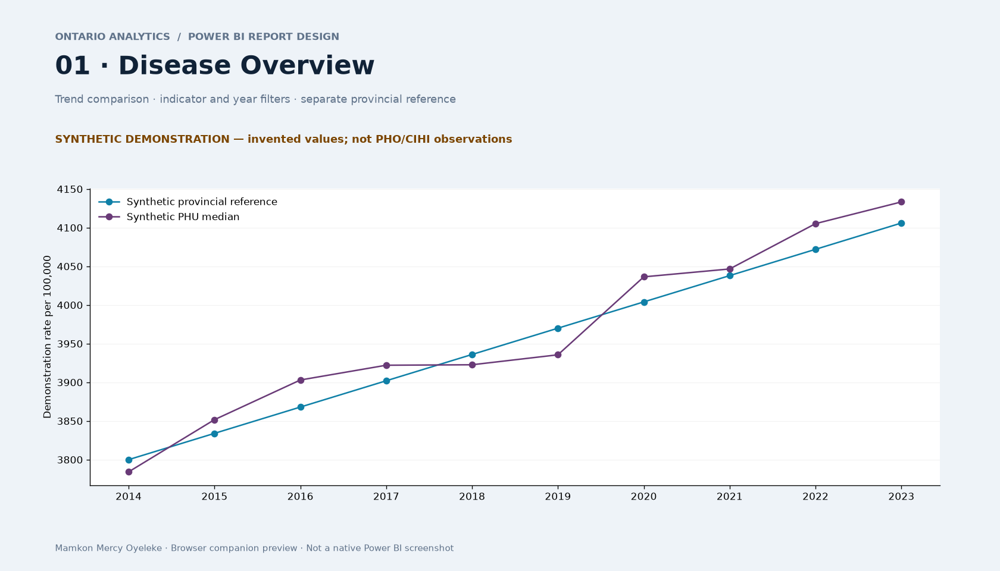
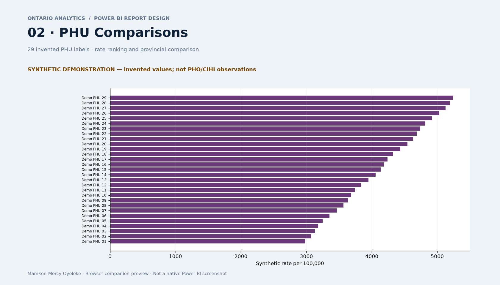
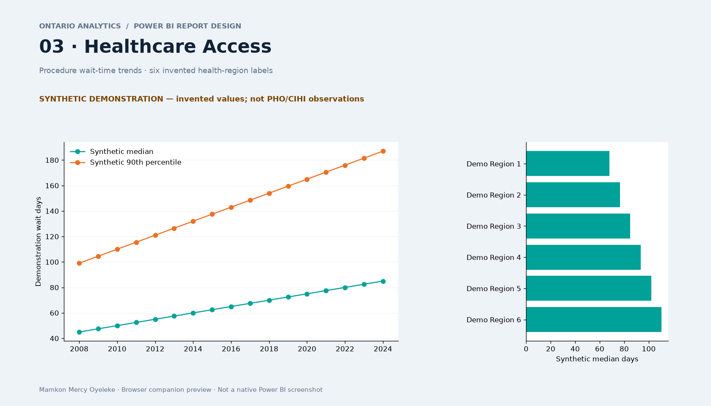

# Ontario Analytics · Power BI

**Chronic disease patterns, PHU comparisons and healthcare access**  
By Mamkon Mercy Oyeleke · Power BI · DAX · Power Query · Python

[Explore the interactive demo](https://mamkon.github.io/ontario-analytics/) · [Portfolio](https://mamkon.github.io/#ontario-powerbi) · [Data and publication review](docs/DATA-AND-PUBLICATION.md)

This project turns historical health statistics into an editable three-page analytical report. It makes trends, geographic comparisons and procedure wait times easier to inspect while preserving the meaning of rates, reporting periods and missing values.

**Public presentation:** the three preview images and browser companion below use independently generated **synthetic data** and invented PHU/health-region labels. They demonstrate the design and interactions, not research findings or live health data. The complete real-data working packages and original previews are retained in a separate private local archive. Publisher data is not bundled with this Power BI presentation folder.

## Report pages

| Page | Analytical purpose | Interactions |
| --- | --- | --- |
| **Disease Overview** | Compare a provincial rate with the unweighted PHU median and inspect historical trends | Indicator and year selection; full-series trend |
| **PHU Comparisons** | Rank PHU rates for one indicator/year and show differences from the provincial reference | Indicator/year slicers; rate and confidence-interval table |
| **Healthcare Access** | Inspect procedure wait times and compare health regions | Procedure/year slicers; median, 90th percentile and benchmark measures |

### Disease Overview



### PHU Comparisons



### Healthcare Access



The PNGs are browser-companion design previews generated from synthetic data, not screenshots exported from Power BI Desktop. The three original real-data images remain in the private archive. GitHub renders the PNGs directly; use the demo link for working filters and charts, since GitHub's source viewer does not execute HTML.

## Objectives and data sources

- Examine variation in chronic disease incidence/prevalence over time and across PHUs.
- Keep Ontario aggregate rates distinct from the unweighted median of individual PHU rates.
- Present healthcare access through procedure-specific wait-time metrics and benchmark percentages.
- Provide a reproducible, editable report and an accessible browser companion.

| Historical input | Publisher and methodology | Coverage used by this report |
| --- | --- | --- |
| `PHO_Chronic_Disease_Inc_Prev_Snapshot_2014_2023.xlsx` | [Public Health Ontario — Chronic Disease Incidence and Prevalence Snapshot](https://www.publichealthontario.ca/en/data-and-analysis/chronic-disease/chronic-disease-incidence-prevalence) | 2014–2023; eight indicators; age-standardized rates, both sexes; 29 individual PHUs in the supplied snapshot |
| `CIHI_Wait_Times_Priority_Procedures_2025.xlsx` | [Canadian Institute for Health Information — 2025 release](https://www.cihi.ca/en/wait-times-for-priority-procedures-in-canada-2025) | 2008–2024; Ontario procedures; four-digit year labels represent April–September reporting periods |

These are the historical input filenames and coverage, not a claim about the publishers' newest releases. The PHO workbook credits ICES Chronic Disease Derived Cohorts. Review source-specific methodology, notices and permissions when obtaining inputs. Neither publisher endorses this independent project.

## Methodology and analytical techniques

**Power Query:** import the original Excel sheets, skip source/title rows, promote headers, type fields, preserve suppression/missingness, separate provincial aggregates from PHUs, and pivot CIHI metrics into distinct columns. FY and Q3Q4 period labels remain in local source extracts but are excluded from the April–September report facts.

**Semantic model:** nine tables and ten relationships. PHO facts have indicator–year–PHU grain, with a separate Ontario fact. CIHI facts separate province and health-region observations at procedure–year grain. Dimensions cover indicators, PHUs, procedures, wait-time regions and years. Shared years support navigation; there is **no automatic PHU-to-CIHI geographic join**.

**DAX:** thirteen measures cover selected rates, PHU median, provincial reference, rate gaps, coverage counts, provincial/regional median and 90th-percentile wait days, benchmark percentages and regional wait gaps. Measures return blank where a compatible single indicator/procedure and year is required. Rates, medians and percentages are not summed. Benchmark inputs on a 0–100 scale are divided by 100 for percentage formatting.

**Analysis:** descriptive trends, ordered regional comparisons, provincial reference gaps and distribution summaries. The dashboard does not calculate causal effects, retrain predictive models, or establish a burden–access correlation. Earlier notebook research is separate from this report and its synthetic public demonstration.

## Open the editable report in Power BI Desktop

1. Download the repository ZIP or clone it, and extract it completely. Navigate to `powerbi/ontario-analytics/`; keep the `.pbip`, `.Report` and `.SemanticModel` folders together.
2. Use a current standard **Power BI Desktop** release supporting PBIP/PBIR. Enable the project/report-format preview options if your version requires them, then restart when prompted. See [Microsoft's report project documentation](https://learn.microsoft.com/en-us/power-bi/developer/projects/projects-report).
3. Obtain authorized copies of the two historical workbooks and place them in `input/`, using the exact filenames and sheet layouts documented in [input/README.md](input/README.md). No workbook, login, API key or cached model data is supplied here.
4. Run `Configure-Source-Folder.ps1` from this folder, or set the Power Query **SourceFolder** parameter to the absolute `input` folder path, including its trailing backslash. The script updates the parameter in your downloaded working copy; preserve your own backup first.
5. Open **`Open-Dashboard.pbip`** in Power BI Desktop, then select **Refresh**. It references `OntarioDashboard.Report` and `Ontario.SemanticModel`. `Ontario.pbip` and `Ontario.Report` are retained as the original project entry and report copy.
6. Select the three page tabs. For cards and comparisons, choose one indicator/procedure and year; clear Year for trend exploration. Blank cards can indicate missing or ambiguous filter context.
7. Import `OntarioTheme.json` through **View → Themes → Browse for themes** if needed. Save a separate `.pbix` copy through Desktop if desired; keep the project folders for version control.

If a `C:\PowerBI\Ontario\...` path error appears, configure **SourceFolder** rather than creating folders at an assumed location. A public clone without authorized workbooks can inspect report/model definitions but cannot refresh actual health data. The synthetic browser demo works without Power BI or source workbooks.

## Browser companion and local automation

- Public: open [the interactive synthetic demo](https://mamkon.github.io/ontario-analytics/) or download and open `demo/index.html` directly. It is self-contained and makes no network/API calls.
- Authorized local data: install Python 3.10+ and run `python -m pip install -r requirements.txt`, then `python serve.py` (or `Start-Dashboard.cmd`). The local service binds to `127.0.0.1:8770` and checks input changes every 60 seconds. Generated CSVs and HTML/PDF reports remain ignored by Git.
- File watching refreshes the local browser/report; it does **not** schedule Power BI Desktop refresh, download new publisher releases or configure Power BI Service refresh. Do not expose the local server publicly without reviewing source permissions and deployment controls.

## Folder structure

```text
ontario-analytics/
├── Open-Dashboard.pbip          # preferred entry point
├── Ontario.pbip                 # retained original entry point
├── OntarioDashboard.Report/     # 3 pages / 26 editable visual definitions
├── Ontario.Report/              # retained original report definition
├── Ontario.SemanticModel/       # model.bim, Power Query, relationships, DAX
├── Measures.dax                 # readable DAX reference
├── PowerQuery.m                 # readable transformation reference
├── OntarioTheme.json            # theme
├── PublisherColours.json        # palette provenance; no publisher logos
├── Configure-Source-Folder.ps1
├── input/                       # authorized local workbooks (gitignored)
├── data/                        # generated local extracts (gitignored)
├── demo/                        # synthetic interactive HTML + JSON
├── previews/                    # 3 synthetic PNG previews
├── docs/                        # methods, rights, preservation, validation
├── scripts/                     # public package validation
├── refresh_data.py              # authorized local source preparation
├── serve.py                     # local browser/report automation
├── dashboard-template.html      # local real-data companion template
├── requirements.txt
└── Start-Dashboard.cmd
```

## Validation, preservation and limitations

See [VALIDATION.md](docs/VALIDATION.md) for the current checks and their limits, [PRESERVATION.md](docs/PRESERVATION.md) for the archive/copy policy, and [DATA-AND-PUBLICATION.md](docs/DATA-AND-PUBLICATION.md) for the publication review. Original validation documents are retained under `docs/original-validation/`; they describe the supplied historical workbooks, not the synthetic demo.

Native report JSON/schema and field-reference checks do not prove Desktop rendering, DAX execution or refresh success. The previous blank-page problem prompted a content-version correction and a fresh project entry point; **successful native rendering of all three pages still needs Desktop verification**. Do not present these PNGs as proof of native rendering.

The report uses PHO-associated purple/blue/teal and CIHI-associated teal/orange, with text labels as well as colour. Values were observed in publisher web assets; this is not a claim of a complete official brand manual. Third-party data and branding are not relicensed by this repository's software licence.
